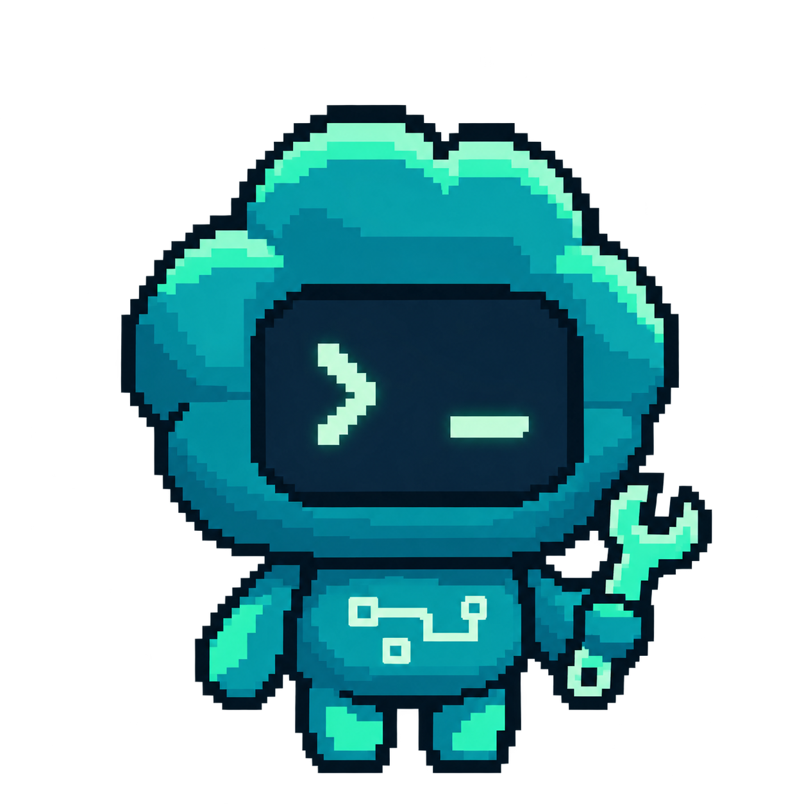
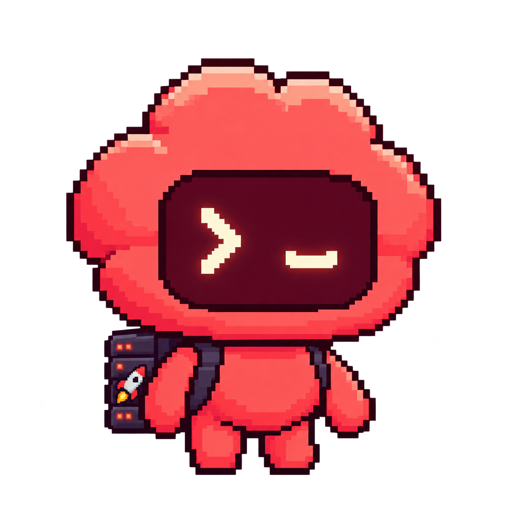
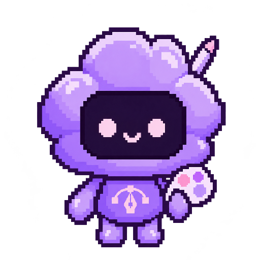
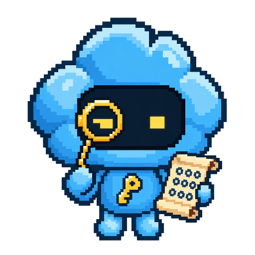

# agent-avatar-generator

A small CLI that generates new agent avatars in one consistent style: a chunky
pixel-art mascot with a big cloud-shaped head, a dark screen for a face, a small
body and a transparent background. Variants differ by palette, face expression,
chest emblem and accessories.

It works by sending one or more of the example avatars as style references to a
reference-conditioned image model (OpenAI `gpt-image-1` via the Images *edit*
endpoint), together with a prompt built from a saved template and a preset.

## Gallery

These are the ten approved TWO avatars in [`examples/`](examples). The first seven
are the originals. Security Engineer, UX Designer and Applied Cryptography Reviewer
were made with this tool.
See [Asset provenance](#asset-provenance).

| Chief of Staff | Engineering Lead | Software Engineer 1 | Software Engineer 2 |
| :---: | :---: | :---: | :---: |
|  |  |  |  |
| `chief-of-staff` | `engineering-lead` | `software-engineer-1` | `software-engineer-2` |

| DevOps Engineer (coral) | QA Reviewer (emerald) | Product Lead (magenta) |
| :---: | :---: | :---: |
|  |  |  |
| `devops-engineer` | `qa-reviewer` | `product-lead` |

| Security Engineer (gunmetal) | UX Designer (lilac) | Applied Cryptography Reviewer (sky blue) |
| :---: | :---: | :---: |
|  |  |  |
| `security-engineer` | `ux-designer` | `applied-cryptography-reviewer` |

## Install

Requires Python 3.10+.

```bash
git clone https://github.com/TogetherWeOwn/agent-avatar-generator
cd agent-avatar-generator
python -m venv .venv && source .venv/bin/activate
pip install -e ".[openai]"     # drop [openai] if you only want --dry-run
```

Dependencies: Pillow and PyYAML. The `openai` extra (`openai>=1.99`) is only
needed to call the API.

Run the commands from the repository root: the default style references are
read from `./examples` (change that with `--examples-dir` or `--reference`).

## API key

Generation needs an OpenAI API key with access to `gpt-image-1`. Set it in the
environment. Never put it in a file in this repository.

```bash
export OPENAI_API_KEY=...        # your own key
```

`--dry-run`, `presets`, `manifest` and the tests do not need a key and make no
network calls.

### OpenAI-compatible endpoints

The client is the official `openai` SDK, so it also reads `OPENAI_BASE_URL`. To
generate through an OpenAI-compatible proxy, point both variables at it and pass
a model that the proxy serves:

```bash
export OPENAI_BASE_URL=https://your-proxy.example/v1
export OPENAI_API_KEY=...        # the proxy's key
agent-avatar generate --preset security-engineer --model gpt-image-2.5 --size 512
```

The `security-engineer`, `ux-designer` and `applied-cryptography-reviewer` examples were made this way, with
`gpt-image-2.5`. If the proxy does not serve the default `gpt-image-1`, always pass `--model`.

## Usage

```bash
agent-avatar presets                                   # list presets

# See exactly what would be sent, without calling the API (no key needed)
agent-avatar generate --preset qa-reviewer --dry-run

# New variant of a preset -> out/qa-reviewer.png
agent-avatar generate --preset qa-reviewer

# Preset with a name, an extra accessory, WebP at 512 px
agent-avatar generate --preset devops-engineer --name "Rusty" \
  --accessory "a tiny yellow hard hat" -o avatars/rusty.webp --size 512

# Recolor a preset and replace its accessories
agent-avatar generate --preset engineering-lead --primary "#3355ff" --highlight "#99aaff" \
  --color-name cobalt --replace-accessories --accessory "a headset with a microphone"

# A new role from scratch (all five colors are required)
agent-avatar generate --role "Data Engineer" --color-name cobalt \
  --primary "#3355ff" --highlight "#99aaff" --outline "#111144" --screen "#050510" --glyph "#ccffee" \
  --face 'a terminal prompt ">_" in place of eyes' --emblem "a small database icon" \
  --accessory "a hard hat"

# From your own YAML spec (same format as src/agent_avatar_generator/presets/*.yaml)
agent-avatar generate --config my-avatar.yaml --dry-run
```

You can also run it as `python -m agent_avatar_generator ...`.

### Options (`agent-avatar generate --help`)

| Option | Meaning |
| --- | --- |
| `--preset ID` / `--config FILE` | start from a bundled preset or your own YAML spec |
| `--role`, `--name` | role/job title and optional character name |
| `--primary --highlight --outline --screen --glyph` | palette colors (`#rrggbb`): body, highlights, outlines/shadows, face screen, face symbols |
| `--color-name` | human name for the palette, used in the prompt |
| `--face`, `--emblem` | face-screen expression and chest emblem (`none` for no emblem) |
| `--accessory` (repeatable), `--replace-accessories` | add accessories, or replace the preset's |
| `--reference` (repeatable) | style reference images. Default: the preset's own example, or `engineering-lead` and `qa-reviewer-emerald` for custom specs |
| `-o/--output`, `--out-dir`, `--format` | explicit `.png`/`.webp` path, or a name derived from name/preset/role inside `--out-dir` (default `out/`) |
| `--size` | square output size in pixels, 32 to 2048 (default 1024) |
| `--overwrite` | allow replacing an existing file (checked before any API call) |
| `--model`, `--quality`, `--input-fidelity` | model (default `gpt-image-1`), `low/medium/high` (default `high`), reference fidelity (default `high`) |
| `--dry-run` | print the full request as JSON and exit |

### Output

- The API is asked for a 1024x1024 PNG with a transparent background. The tool
  then resizes it to `--size` with nearest-neighbour scaling (keeps pixel edges
  crisp) and writes PNG or lossless WebP with the alpha channel intact.
- If the model returns an image with no transparent pixels, the file is still
  saved and a warning is printed, so you are not charged twice for a retry you
  did not want.
- The output directory is created and checked before the API call, and the file
  is created exclusively unless you pass `--overwrite`. If saving still fails
  after a paid call, the raw image is kept in a temporary file and its path is printed.
- Derived filenames are reduced to `[a-z0-9-]`, so `--name "../../x"` becomes
  `out/x.png`. An explicit `-o` path is used as given; only its extension is checked.

## Presets

Presets live in [`src/agent_avatar_generator/presets/`](src/agent_avatar_generator/presets).
For the seven original presets, palettes and accessories were inferred by
inspecting the example images. The `security-engineer`, `ux-designer` and
`applied-cryptography-reviewer` presets are the specs their examples were generated from.
The prompt template is
[`src/agent_avatar_generator/templates/avatar_prompt.txt`](src/agent_avatar_generator/templates/avatar_prompt.txt).

| Preset | Color | Accessories / attributes |
| --- | --- | --- |
| `chief-of-staff` | butter yellow `#fde99f` | happy closed eyes, maroon necktie, gold clipboard |
| `engineering-lead` | violet `#673bef` | `>_` face, three antennae with glowing tips, org-chart emblem |
| `software-engineer-1` | teal `#02899c` | `>_` face, wrench, circuit-trace emblem |
| `software-engineer-2` | orange `#fa8f1f` | `> <` face, mechanical keyboard, tool belt |
| `devops-engineer` | coral `#f85053` | winking `>_` face, server-rack backpack with rocket sticker |
| `qa-reviewer` | emerald `#28e179` | happy eyes, magnifying glass, checkmark emblem |
| `product-lead` | magenta `#fb5dba` | winking `>_` face, roadmap clipboard, lightbulb emblem |
| `security-engineer` | gunmetal steel `#7d8ca3` | `- -` watchful eyes, gold padlock, cyan shield-and-keyhole emblem |
| `ux-designer` | lilac `#c39bf6` | dot eyes and smile, paint palette, stylus, pen-tool emblem |
| `applied-cryptography-reviewer` | sky blue `#46b3f0` | focused square eyes, gold monocle, hex ciphertext scroll, gold key emblem |

## Manifest

[`manifest.json`](manifest.json) maps each example to its preset, SHA-256,
dimensions and generation recipe (prompt template, parameters, full request).
It is generated from the presets and the files, and CI fails if it drifts:

```bash
agent-avatar manifest           # check: files exist, hashes match, every preset has an example
agent-avatar manifest --write   # regenerate after changing presets or the template
```

## Non-determinism and cost

- Image generation is **not deterministic**. The same command gives a
  different image every time, and results will not exactly match the examples.
  Expect to generate a few candidates and pick one. Nothing here promises exact
  repeatability.
- Each `generate` without `--dry-run` is one billable API call. At the time of
  writing, a 1024x1024 `gpt-image-1` image costs very roughly **US$0.05 to
  $0.25** at `--quality high`, including reference-image input tokens (`high`
  input fidelity costs more). `--quality medium` or `low` is cheaper. Check
  OpenAI's current pricing page before generating in bulk.

## Development

```bash
pip install -e ".[test]"
pytest
```

The tests run fully offline. They mock the image client, block sockets, and
never need an API key. They cover preset and config loading, prompt
construction, safe output filenames, size and transparency handling, and
manifest consistency. CI (GitHub Actions) runs them on Python 3.10 and 3.12,
along with `agent-avatar manifest` and a dry run.

## Asset provenance

The example avatars were AI-generated for TWO and are included as approved.
The `recipe` entries describe how this tool makes a new variant
in the same style; they are not the exact original prompts. This project is not
affiliated with or endorsed by OpenAI. See [ASSETS.md](ASSETS.md) for details.

## License

Code: [MIT](LICENSE). Images: not covered by the MIT license, see [ASSETS.md](ASSETS.md).
